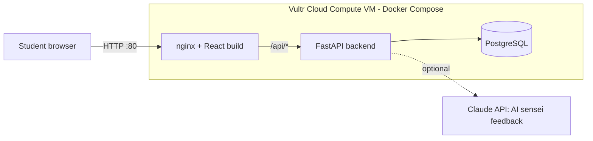

# Architecture

## Use case
Developers are expected to review code on day one but are never trained to. Review Dojo gives them
realistic pull requests with planted flaws (bugs, security, performance, design), scores their review
against an answer key, and explains every flaw.

## Components
| Part | Tech | Job |
|---|---|---|
| Frontend | React + TypeScript + Vite | PR viewer, inline comments, results, profile, leaderboard |
| Backend | FastAPI (Python) | REST API, auth (JWT), scoring engine, optional AI mentor |
| Database | PostgreSQL | users, exercises (with hidden flaws), reviews |
| Proxy | nginx | serves the build, proxies /api to the backend |
| Hosting | Vultr Cloud Compute + Docker Compose | one VM, three containers |

## Scoring engine (backend/app/scoring.py)
1. Each comment is matched to the nearest planted flaw in the same file within 2 lines.
2. Flaws are weighted by severity (low 1, medium 2, high 3, critical 4).
3. A caught flaw earns 60% for locating it, +30% if the comment names the problem (keyword match), +10% for a clear reason.
4. Comments that match no flaw are false alarms (small penalty, capped at 25%).
5. Score = earned / max points, 0-100, mapped to belts: White, Green, Brown, Black, Sensei.
6. The answer key never leaves the server before the review is submitted.

## API
`POST /api/auth/register|login` · `GET /api/exercises` · `GET /api/exercises/{id}` ·
`POST /api/exercises/{id}/submit` · `GET /api/me/stats` · `GET /api/leaderboard` · `GET /api/health`

## Game layer (backend/app/game.py)
- XP for a review = score + 5 per severity point caught + 25 bonus for 90+. XP only counts when you beat your previous best on that pull request (no farming).
- Level = floor(sqrt(XP / 40)) + 1. Titles: Script Kiddie, Packet Sniffer, Bug Hunter, Code Auditor, Exploit Analyst, Red Teamer, Zero-Day Hunter, Shadow Admin.
- Intermediate pull requests unlock at level 2, advanced at level 3 (enforced by the API, not just the UI).
- Achievements and streaks are computed from review history.
